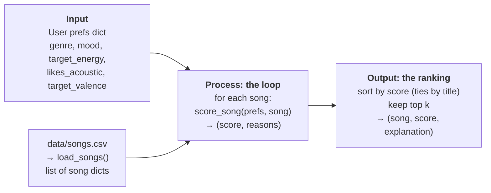

# 🎵 Music Recommender Simulation

## Project Summary

In this project you will build and explain a small music recommender system.

Your goal is to:

- Represent songs and a user "taste profile" as data
- Design a scoring rule that turns that data into recommendations
- Evaluate what your system gets right and wrong
- Reflect on how this mirrors real world AI recommenders

Replace this paragraph with your own summary of what your version does.

---

## How The System Works

Real-world platforms like Spotify and YouTube combine two main approaches. Collaborative filtering looks at what similar users listened to. Content-based filtering compares the attributes of the songs themselves. Behind both is a two-step design: a model scores how well each item fits the user, and a separate ranking step builds the final list, handling things like variety and freshness. My version is a small content-based recommender that follows the same two steps. A scoring rule rates one song against the user's taste profile, and a ranking rule scores every song in the catalog, sorts them, and returns the top `k`. It prioritizes **genre** first, then **mood** and **energy**, with **acousticness** as a smaller tie-breaker. Each part of the score also produces a short reason, so every recommendation can be explained.

### Features used

**`Song`**

| Feature | Used in scoring? | How |
|---|---|---|
| `genre` | Yes | +2.0 for an exact match, +1.0 for a partial match that shares a whole word (e.g. "pop" ↔ "indie pop"). Matching ignores capital letters and extra spaces |
| `mood` | Yes | +1.0 if it matches the user's favorite mood |
| `energy` | Yes | Up to +1.5 for closeness: `1.5 × (1 − abs(energy − target_energy))` |
| `acousticness` | Yes | Up to +0.5: rewards high acousticness if the user likes acoustic, low otherwise |
| `tempo_bpm` | No | Closely follows energy in this dataset, so it would count the same signal twice |
| `valence` | Yes (optional) | Up to +1.0 for closeness to `target_valence`, only if the profile sets it |
| `danceability` | No | Possible future addition; the profile has no matching preference yet |
| `mood_tags` | Yes (optional) | +0.5 per tag shared with `desired_mood_tags`, up to +1.0 |
| `release_decade` | Yes (optional) | +0.75 for the user's `favorite_decade`, +0.35 for a neighboring decade |
| `popularity` (0–100) | Yes (optional) | Up to +0.5 for closeness to `target_popularity` |
| `instrumentalness` | Yes (optional) | Up to +0.5 for closeness to `target_instrumentalness` |
| `language` | Yes (optional) | +0.5 if it matches `preferred_language`; +0.25 for instrumental songs |
| `id`, `title`, `artist` | No | Used only to identify and display songs |

**`UserProfile`**

- `favorite_genre`: the genre to match exactly
- `favorite_mood`: the mood to match exactly
- `target_energy`: the preferred energy level (0–1)
- `likes_acoustic`: whether the user prefers acoustic-sounding songs
- `target_valence` *(optional)*: how positive the user wants songs to sound (0–1)
- `desired_mood_tags` *(optional)*: a list of detailed moods, e.g. `["nostalgic", "late-night"]`
- `favorite_decade` *(optional)*: e.g. `2010`
- `target_popularity` *(optional)*: 0–100. Low means underground, high means mainstream
- `target_instrumentalness` *(optional)*: 0–1. High means the user wants songs without vocals
- `preferred_language` *(optional)*: e.g. `"english"`

### Algorithm recipe

**Scoring rule (one song):** start at 0 and add points:

| Rule | Points | Why this weight |
|---|---|---|
| Genre exact match | +2.0 | Genre is the most stable part of a person's taste, so it carries the most weight |
| Genre partial match | +1.0 | Related genres ("indie pop" for a pop fan) deserve some credit, not zero |
| Mood match | +1.0 | Mood changes with the moment, and the labels are sparse and exact, so it counts half as much as genre |
| Energy closeness | 0 to +1.5 | `1.5 × (1 − abs(energy − target_energy))`. Rewards being *close* to the target, not just high or low |
| Acoustic preference | 0 to +0.5 | `acousticness` if `likes_acoustic`, else `1 − acousticness`. Small because it mostly repeats energy |
| Valence closeness | 0 to +1.0 | `1 − abs(valence − target_valence)`, skipped if not set. Breaks ties between high-energy songs with different feelings (euphoric EDM vs. angry metal) |
| Mood tags | 0 to +1.0 | +0.5 per shared tag. Gives partial credit for *close* moods, which the single exact `mood` label can't ("happy" vs. "euphoric") |
| Decade | +0.75 / +0.35 | Exact decade or the one next to it. Captures "era" taste without letting it beat genre |
| Popularity closeness | 0 to +0.5 | `0.5 × (1 − abs(popularity − target) / 100)`. Lets a user lean mainstream or underground |
| Instrumentalness closeness | 0 to +0.5 | Helps study or focus listeners who want no vocals |
| Language | +0.5 / +0.25 | Full credit for the preferred language, half for instrumental songs, which have no language barrier |

The advanced rules (the last five) only run when the profile sets them, and each is worth at most 1.0, so they refine the ranking without overpowering genre. With the core features, the maximum score is 6.0; with every advanced preference set, it's 9.25. Genre beats mood by design: a genre match with average energy (2.0 + ~0.75) still outscores a mood-only match with perfect energy (1.0 + 1.5). Energy is the strongest numeric signal because every song gets a score for it, while genre and mood points only go to the few songs that match.

**Ranking rule (whole list):** score every song, sort from highest to lowest, break ties by title, and return the top `k` (default 5) together with each song's reasons.

### Data flow



1. **Input:** `main.py` builds the user prefs dictionary, and `load_songs()` reads `data/songs.csv` into a list of song dictionaries (converting numeric columns to floats).
2. **Process:** `recommend_songs()` loops over *every* song and calls `score_song()` on it. Each song is judged on its own against the same profile, producing a score and a list of reasons such as `"genre match (+2.0)"`.
3. **Output:** the scored songs are sorted from highest to lowest, ties are broken by title, and the top `k` are returned as `(song, score, explanation)` for `main.py` to print.

### Expected biases

- **Genre dominates.** A genre match (+2.0) is worth as much as a perfect mood match and a perfect valence match combined. A happy pop fan will see an *intense* pop song (Gym Hero) above *Island Time*, an uplifting reggae song with almost the same positivity, simply because of the genre label.
- **Exact mood labels miss close matches.** "euphoric" and "uplifting" earn no mood points for a user who wants "happy," even though they mean nearly the same thing. Valence partly makes up for this, but only when the profile sets it.
- **Uneven catalog.** Lofi has 3 songs, while most genres have just 1. A lofi fan gets a full list of genre matches; a metal or folk fan gets one match and then songs picked mostly by energy.
- **Energy counts twice.** Acousticness closely follows energy in this data, so loud, produced songs and quiet, acoustic songs get a double reward or penalty. Mid-energy acoustic songs (e.g. Dusty Porch Swing) fall in between and can be overlooked.
- **The tie-break isn't neutral.** Breaking ties alphabetically always favors titles earlier in the alphabet, which is arbitrary from the listener's point of view.

---

## Getting Started

### Setup

1. Create a virtual environment (optional but recommended):

   ```bash
   python -m venv .venv
   source .venv/bin/activate      # Mac or Linux
   .venv\Scripts\activate         # Windows

2. Install dependencies

```bash
pip install -r requirements.txt
```

3. Run the app:

```bash
python -m src.main
```

### Running Tests

Run the starter tests with:

```bash
pytest
```

You can add more tests in `tests/test_recommender.py`.

---

## Sample Recommendation Output

Output of `python -m src.main` for the first profile, High-Energy Pop. The full run covers 10 profiles. The model card's Evaluation section walks through the first seven.

```
Loaded songs: 18

### High-Energy Pop
User profile: favorite_genre=pop, favorite_mood=happy, target_energy=0.8, likes_acoustic=False, target_valence=0.8
============================================================
1. Sunrise City by Neon Echo
   pop / happy   Score: 5.84
     - genre match (+2.0)
     - mood match (+1.0)
     - energy 0.82 vs target 0.80 (+1.47)
     - produced, non-acoustic sound (+0.41)
     - positivity 0.84 vs target 0.80 (+0.96)
------------------------------------------------------------
2. Rooftop Lights by Indigo Parade
   indie pop / happy   Score: 4.75
     - related genre: indie pop (+1.0)
     - mood match (+1.0)
     - energy 0.76 vs target 0.80 (+1.44)
     - produced, non-acoustic sound (+0.33)
     - positivity 0.81 vs target 0.80 (+0.99)
------------------------------------------------------------
3. Gym Hero by Max Pulse
   pop / intense   Score: 4.75
     - genre match (+2.0)
     - energy 0.93 vs target 0.80 (+1.30)
     - produced, non-acoustic sound (+0.47)
     - positivity 0.77 vs target 0.80 (+0.97)
------------------------------------------------------------
4. Lightspeed Rave by Pulse Theory
   edm / euphoric   Score: 2.69
     - energy 0.95 vs target 0.80 (+1.28)
     - produced, non-acoustic sound (+0.49)
     - positivity 0.88 vs target 0.80 (+0.92)
------------------------------------------------------------
5. Golden Hour Bars by Kilo Static
   hip hop / confident   Score: 2.58
     - energy 0.68 vs target 0.80 (+1.32)
     - produced, non-acoustic sound (+0.44)
     - positivity 0.62 vs target 0.80 (+0.82)
------------------------------------------------------------
```

These results match what the recipe should produce. The only song that matches both genre and mood (Sunrise City) is clearly first. The two partial matches come next: Rooftop Lights (related genre + mood) and Gym Hero (genre only). Rooftop Lights edges ahead, 4.755 to 4.750, which both round to 4.75. After that there are no pop or happy songs left, so places 4–5 are decided only by energy, acousticness and positivity. Lightspeed Rave's upbeat, euphoric sound puts it ahead of darker high-energy songs like Iron Cathedral.

**Screenshot or video** *(optional)*: <!-- Insert a screenshot or demo video link here -->

---

## Experiments You Tried

### Experiment 1: Weight shift (genre halved, energy doubled)

**Change:** genre exact match 2.0 → 1.0, partial match 1.0 → 0.5, energy closeness 1.5 → 3.0. Mood, acousticness and valence stayed the same.

**Hypothesis:** with genre counting for less, songs that match the user's mood and feel would rise, fixing the "Sad Banger" problem where a euphoric EDM song beat the only sad song.

Top 5 for every profile, before (left) and after (right):

```
High-Energy Pop
  1. Sunrise City           5.84  |  Sunrise City           6.31
  2. Rooftop Lights         4.75  |  Rooftop Lights         5.70
  3. Gym Hero               4.75  |  Gym Hero               5.05
  4. Lightspeed Rave        2.69  |  Lightspeed Rave        3.96
  5. Golden Hour Bars       2.58  |  Night Drive Loop       3.93

Chill Lofi
  1. Library Rain           5.93  |  Library Rain           6.43
  2. Midnight Coding        5.71  |  Midnight Coding        6.10
  3. Focus Flow             4.80  |  Focus Flow             5.23
  4. Spacewalk Thoughts     3.80  |  Spacewalk Thoughts     5.20
  5. Coffee Shop Stories    2.81  |  Coffee Shop Stories    4.27

Deep Intense Rock
  1. Storm Runner           5.90  |  Storm Runner           6.39
  2. Gym Hero               3.61  |  Gym Hero               5.06
  3. Iron Cathedral         2.67  |  Iron Cathedral         4.06
  4. Night Drive Loop       2.62  |  Lightspeed Rave        3.91
  5. Lightspeed Rave        2.49  |  Night Drive Loop       3.90

Edge: Sad Banger (conflicting mood vs. energy)
  1. Lightspeed Rave        4.24  |  Lightspeed Rave        4.66
  2. Iron Cathedral         2.84  |  Iron Cathedral         4.23
  3. Storm Runner           2.65  |  Storm Runner           4.14
  4. Paper Boats            2.63  |  Gym Hero               3.82
  5. Night Drive Loop       2.38  |  Night Drive Loop       3.65

Edge: Capitalized Genre ('Pop' vs. 'pop')
  1. Sunrise City           1.88  |  Sunrise City           3.35
  2. Night Drive Loop       1.81  |  Night Drive Loop       3.24
  3. Storm Runner           1.78  |  Rooftop Lights         3.21
  4. Gym Hero               1.78  |  Storm Runner           3.12
  5. Lightspeed Rave        1.77  |  Gym Hero               3.08

Edge: Out-of-Range Energy (1.5)
  1. Moonlit Sonata Redux   1.52  |  Iron Cathedral         1.41
  2. Iron Cathedral         0.70  |  Lightspeed Rave        1.35
  3. Lightspeed Rave        0.67  |  Gym Hero               1.29
  4. Gym Hero               0.65  |  Storm Runner           1.23
  5. Storm Runner           0.61  |  Sunrise City           0.96

Edge: Empty Profile  (unchanged: every song still scores 0.00)
```

**Result: different, not more accurate. In places it's worse.**

- **The top 3 didn't change for any normal profile.** Songs that match genre, mood *and* energy win under either set of weights. The system holds up well for clear, consistent tastes.
- **The case it was meant to fix got worse.** In "Sad Banger," Lightspeed Rave is still #1, and Paper Boats, the *only* sad song, dropped out of the top 5 entirely. Upbeat Gym Hero (valence 0.77) replaced it. Doubling energy punished Paper Boats' low energy twice as hard, which outweighed the genre change.
- **Lower ranks became "loudness matching."** For the rock fan, euphoric EDM climbed above moody synthwave. For the out-of-range profile, the classical song the user asked for dropped out completely.
- **What it showed:** the real problem isn't that genre is too strong. It's that mood and valence are too weak compared with the "easy" signals. Energy now gives up to 3.0 of a possible 6.5 points, so the system mostly asks "is it the right loudness?" A better next experiment is raising valence/mood instead of energy.

---

## Limitations and Risks

Summarize some limitations of your recommender.

Examples:

- It only works on a tiny catalog
- It does not understand lyrics or language
- It might over favor one genre or mood

You will go deeper on this in your model card.

---

## Reflection

Read and complete `model_card.md`:

[**Model Card**](model_card.md)

Write 1 to 2 paragraphs here about what you learned:

- about how recommenders turn data into predictions
- about where bias or unfairness could show up in systems like this


